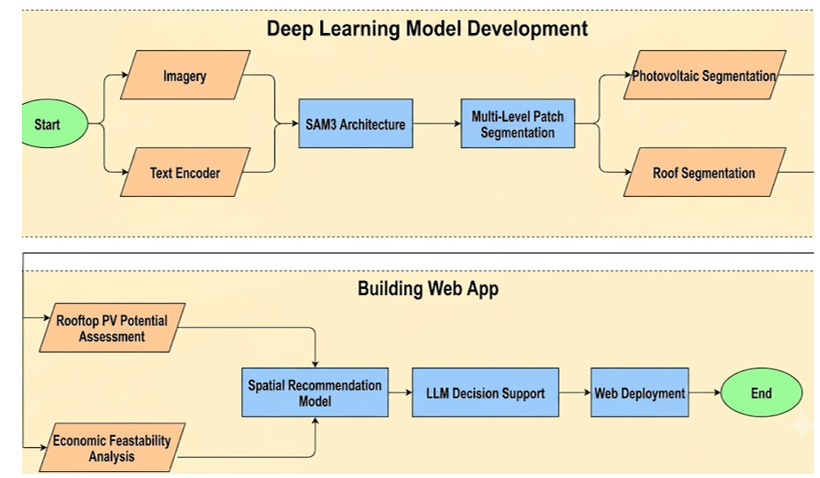
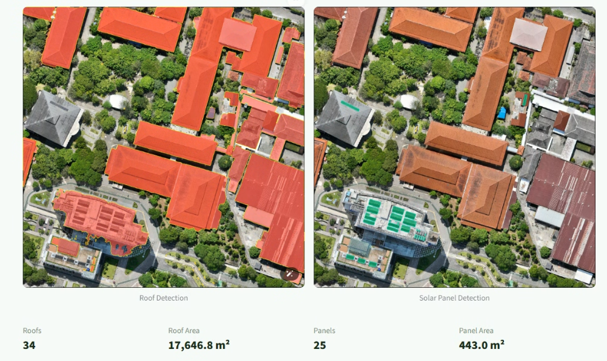
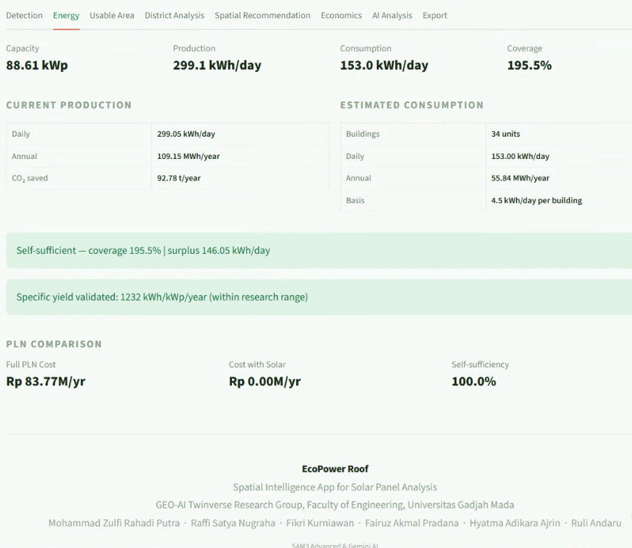
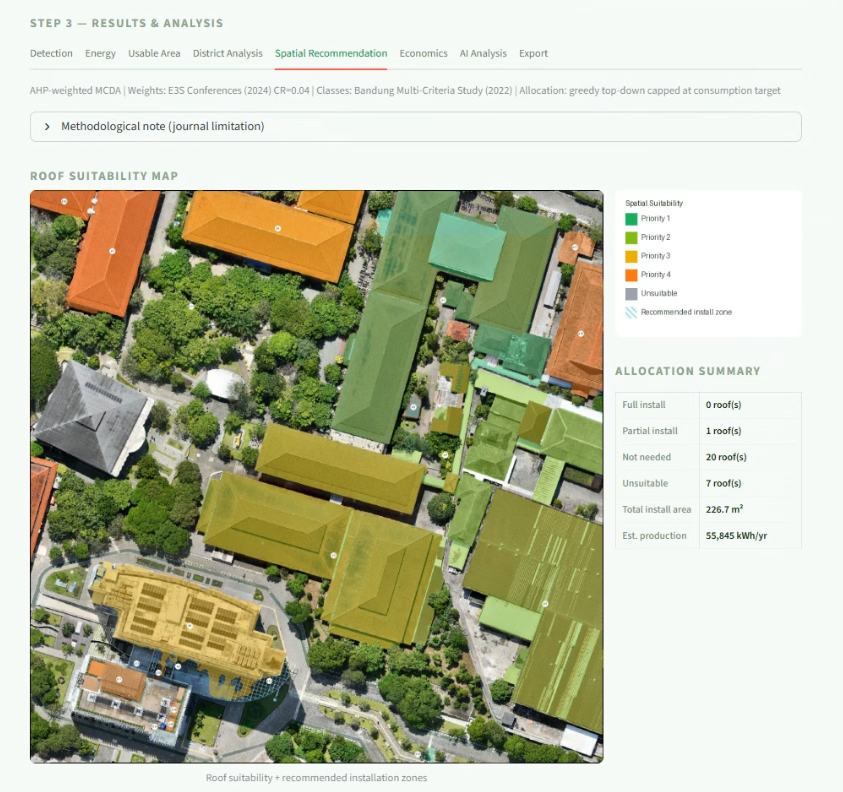
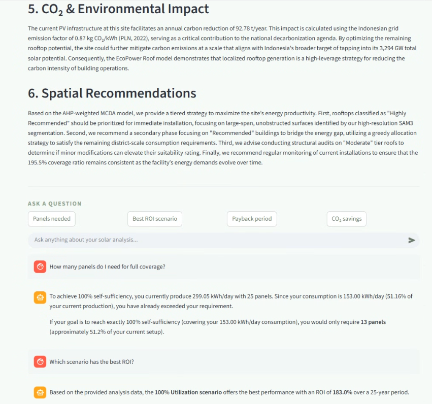

# EcoPower Roof

[](https://choosealicense.com/licenses/mit/)
[](https://www.python.org/)
[](https://streamlit.io/)
[](https://pytorch.org/)
[](https://openreview.net/pdf/c01d0dd8d4e7179b0952062eff08eb52c8d8c322.pdf)

> Built on [SAM3](https://github.com/facebookresearch/sam3) by Meta AI Research
> a unified, promptable segmentation model supporting language, exemplar, and visual
> prompts across images and videos (ICLR 2026).

**EcoPower Roof** is a scalable geospatial AI framework for urban rooftop solar potential
assessment. It integrates hierarchical deep learning segmentation via SAM3, techno-economic
modeling, AHP-weighted multi-criteria decision analysis (MCDA), and an LLM-assisted planning
dashboard — bridging the gap between complex geospatial outputs and actionable urban energy
policy for Indonesian municipalities.

For full setup, configuration, and deployment instructions, see [TECHNICAL.md](Technical.md).

---

## Table of Contents

- [Features](#features)
- [Framework Architecture](#framework-architecture)
- [How It Works](#how-it-works)
- [Dashboard Showcase](#dashboard-showcase)
- [Model Performance](#model-performance)
- [Statistical Validation](#statistical-validation)
- [Case Study Results](#case-study-results)
- [Reproducing the Results](#reproducing-the-results)
- [Team](#team)
- [Acknowledgments](#acknowledgments)
- [License](#license)

---

## Features

### Hierarchical Rooftop Segmentation
- SAM3-based multi-scale patch inference for precise rooftop boundary detection
- Simultaneous identification of existing PV installations
- GeoTIFF support with automatic geospatial metadata extraction
- Adaptive processing across large-scale, medium-scale, and small-scale features
- Cross-level fusion by pixel union, overlap-consensus blending, and spatial validation

### Rooftop Recovery Post-Processing
- Excess Green vegetation index computed on chromatic coordinates, for RGB-only imagery
- Restoration of roof regions discarded by the geometric filter
- Filling of gaps fully enclosed by detected roof
- False-negative decomposition by cause: boundary, filter, enclosure, or missed building

### Techno-Economic Modeling
- Morphological inner buffering applied directly to SAM3 polygons for measured setback
- Reduction cascade for the factors a 2-D outline cannot measure: building type, HVAC,
  structural capacity, and tilt
- Module-specific capacity from published manufacturer datasheets, not an assumed power density
- Six-module catalogue spanning TOPCon, all-back-contact, and heterojunction technologies
- PV-suitable area derived from physical module dimensions
- Energy balance computation: annual yield, self-sufficiency ratio, and CO2 reduction
- Financial analysis: NPV, LCOE, lifetime ROI, and payback period projections

### Terrain Slope & Orientation
- Province-wide DEM cropping to each site extent, with full provenance metadata
- Horn 3x3 slope and aspect at native resolution
- Tilt x heading yield grid via anisotropic sky transposition
- Three-source loss range: analytic, literature-anchored, and optional hourly simulation
- Reported as a quantified limitation; headline energy is unchanged unless explicitly enabled

### Spatial Recommendation via MCDA
- AHP-weighted multi-criteria scoring across four utilization scenarios (25%, 50%, 75%, 100%)
- Published pairwise comparison matrix with eigenvector weights and consistency ratio
- Five-tier prioritization output per site
- GIS-integrated spatial ranking for municipal planning workflows

### LLM-Assisted Planning Dashboard
- Gemini AI integration for natural language report synthesis
- Six-section structured planning narrative per assessed site
- Interactive chatbot interface for planners and energy agencies
- Token and cost accounting per site and per query
- JSON export for downstream GIS or policy workflows

### Statistical Validation Suite
- Spatial-block resampling to control for autocorrelation
- Monte Carlo calibration/test splits, block bootstrap, and leave-one-city-out generalisation
- Hierarchy-level ablation across every subset of the three inference scales
- Building-level significance testing with effect sizes and multiplicity correction
- Classical SLIC + region-adjacency baseline for comparison

---

## Framework Architecture

```
EcoPower Roof
|
+-- 1. Patch Segmentation (SAM3 Backbone)
|   +-- Multi-level rooftop boundary detection
|   +-- PV installation mask identification
|   +-- Cross-level fusion (union / consensus / validation)
|   +-- Recall recovery (Excess Green vegetation mask)
|   +-- GeoTIFF geospatial metadata extraction
|
+-- 2. Techno-Economic Modeling
|   +-- Usable area
|   |   +-- Morphological inner buffer (measured setback)
|   |   +-- Building type factor
|   |   +-- HVAC obstruction factor
|   |   +-- Structural capacity factor
|   |   +-- Panel tilt correction factor
|   +-- Module catalogue (six datasheet modules)
|   |   +-- Capacity, yield, and PV-suitable area per module
|   |   +-- Temperature derating and degradation warranty
|   +-- Energy balance (kWh/yr, self-sufficiency %)
|   +-- Financial analysis (NPV / LCOE / lifetime ROI)
|   +-- CO2 reduction (t/yr @ 0.85 kg CO2/kWh)
|
+-- 3. Terrain Slope & Orientation
|   +-- DEM crop to site extent with provenance
|   +-- Horn slope and aspect
|   +-- Tilt x heading yield grid
|   +-- Loss range (analytic / literature / simulated)
|
+-- 4. Spatial Recommendation (AHP-MCDA)
|   +-- Pairwise comparison matrix (CR = 0.034)
|   +-- Utilization scenarios: 25% / 50% / 75% / 100%
|   +-- Prioritization tiers:
|       +-- Priority 1 : Highly Recommended
|       +-- Priority 2 : Recommended
|       +-- Priority 3 : Conditionally Viable
|       +-- Priority 4 : Low Priority
|       +-- Tier 5     : Not Recommended
|
+-- 5. LLM Planning Dashboard
    +-- Six-section structured site report
    +-- Interactive natural language Q&A
    +-- Token and cost accounting
    +-- Actionable planning narrative output
```

---

## How It Works

The diagram below illustrates the end-to-end hierarchical pipeline from raw aerial
imagery input through SAM3 patch segmentation, techno-economic modeling, AHP-MCDA
spatial prioritization, and finally LLM-assisted planning report generation.



*End-to-end hierarchical workflow: SAM3 segmentation → techno-economic modeling → AHP-MCDA prioritization → LLM planning output*

For a detailed technical walkthrough of each pipeline stage, including configuration,
deployment, and module-level documentation, refer to [TECHNICAL.md](Technical.md).

---

## Dashboard Showcase

### Rooftop Detection & PV Segmentation



*SAM3-based multi-scale rooftop boundary segmentation on aerial imagery*
*Existing solar panel identification with coverage area metrics*

---

### Energy & Economic Analysis



*Annual energy yield, self-sufficiency ratio, and financial projections*

---

### MCDA Spatial Prioritization Map



*AHP-weighted prioritization tiers across assessed rooftop sites*

---

### LLM Planning Report



*Gemini AI-generated six-section structured planning narrative*

---

## Model Performance

Validated across six sites in Yogyakarta, Jakarta, and Surabaya
without site-specific retraining. Figures are from the fully automatic
pipeline, averaged over sites, with 95% block-bootstrap confidence
intervals:

| Metric | Roof Segmentation | PV Detection |
|---|---|---|
| IoU | 75.33% (72.76–77.78) | 77.48% (64.61–84.03) |
| Precision | 96.19% (95.28–96.90) | 79.35% (65.67–86.32) |
| Recall | 77.75% (75.14–80.24) | 96.98% (95.90–98.17) |
| F1-Score | 85.79% (83.97–87.40) | 87.27% (77.24–91.26) |
| Accuracy | 89.49% | 99.41% |

Rooftop segmentation achieves high precision on large heterogeneous surfaces,
while PV detection prioritizes high recall for smaller, visually distinct panel
areas — reflecting a complementary performance trade-off suited to the
dual-class inference task.

Roof metrics cover all six sites; PV metrics cover the three sites with
existing installations. The wider PV intervals reflect the small number of
PV objects per site rather than instability in the segmentation.

---

## Statistical Validation

### Variability across calibration/test splits

Post-processing parameters calibrated on 70% of spatial blocks and evaluated
on the remainder, over 100 Monte Carlo iterations:

| Protocol | Roof IoU | Roof F1 |
|---|---|---|
| Reported configuration, no tuning | 75.33% | 85.79% |
| Monte Carlo (100 splits) | 82.97% ± 1.12 | 90.54% ± 0.69 |
| Leave-one-site-out | 83.13% ± 6.82 | — |
| Leave-one-city-out | 83.13% ± 5.99 | — |

Parameters calibrated on some cities transfer to unseen cities, which supports
the zero-shot deployment claim.

### Hierarchy level ablation

Every subset of the three inference scales, compared against the full
hierarchy by Wilcoxon signed-rank test on spatial blocks with Holm correction:

| Levels | Roof IoU | PV IoU |
|---|---|---|
| Full image only | 62.99% | 81.92% |
| 512 x 512 only | 70.44% | **86.06%** |
| 256 x 256 only | 63.76% | 81.34% |
| Full + 512 | 73.56% | 80.99% |
| Full + 256 | 71.53% | 78.72% |
| 512 + 256 | 73.27% | 82.86% |
| **All three levels** | **75.33%** | 77.48% |

For rooftops the full hierarchy outperforms every single-level and two-level
configuration (Holm-adjusted p <= 5e-5). For PV panels it does not: the
512 x 512 level alone scores higher, because the full-image level introduces
false positives on small bright roof structures. This motivates class-specific
level selection, and is reported as such rather than tuned away.

At building level across 305 reference rooftops, the hierarchy improves median
IoU by 2.41 points over the best single scale (p = 1.9e-14, rank-biserial
r = 0.52), improving 203 buildings and degrading 89.

### Comparison against a classical hierarchy

A SLIC superpixel and region-adjacency-graph merging baseline, calibrated on
the same blocks, reaches 68.86% roof IoU and 33.97% PV IoU, against 73.59% and
76.68% for EcoPower Roof on identical test blocks. Colour homogeneity alone
does not delimit rooftops in RGB imagery; object-level masks from a foundation
model do.

### Processing performance

| Property | Value |
|---|---|
| GPU | NVIDIA GeForce RTX 5060 Ti, 16 GB |
| CPU / RAM | AMD Ryzen 7 7700, 16 threads / 64 GB |
| Runtime per 200 x 200 m site | 118–129 s per class |
| Both classes per site | ~4 minutes |
| Peak VRAM | 4.3–8.7 GB |

---

## Case Study Results

Assessed across **34 structures** covering **17,646.76 m2** with
**25 existing PV installations** identified:

| Metric | Value |
|---|---|
| Gross segmented rooftop area | 17,646.8 m2 |
| Usable area after reduction | 6,256.6 m2 (35.4%) |
| PV-suitable area by module dimensions | 5,317 m2 (85.0% of usable) |
| Additional PV Potential | 1,224 kWp |
| Capacity spread across six modules | 8.6% (1,213–1,317 kWp) |
| Self-Sufficiency at PV Sites | > 195.5% |
| Return on Investment (25-year lifetime) | 183.0% |
| Payback Period | 8.8 years |
| Annual CO2 Reduction | 92.78 t/yr |
| Emission Factor Applied | 0.85 kg CO2/kWh |

Installable capacity depends measurably on module selection. Across six
commercially available modules evaluated on an identical roof, capacity varies
by 8.6%. On area-limited urban sites efficiency is the dominant lever, so the
highest-efficiency module returns the greatest energy per square metre.

LLM planning reports cost approximately USD 0.0015 per site, or around USD 1.50
for a thousand-district deployment.

---

## Reproducing the Results

Imagery and reference data are not redistributed in this repository. Supply
your own under:

```
input/
  01 DATA/
    IMAGE/     200 x 200 m orthophotos at 10 cm GSD, GeoTIFF
    GT/        reference rooftop and PV polygons, shapefile
    DEM/       per-site cropped DEMs, written by prepare_dem.py
  DEM/         province-wide DEM tiles
```

Site naming drives the pipeline: `JKT_ROOF`, `JKT_PV`, `JOG_ROOF`, `JOG_PV`,
`SBY_ROOF`, `SBY_PV`. The case study figures above come from `JOG_PV`.

### Segmentation and evaluation

```bash
python run_batch_inference.py                 # SAM3 across all sites, both classes
python evaluate_inference.py --object-recall  # IoU, precision, recall, F1 per site
```

### Analysis modules

| Output | Command |
|---|---|
| Recall recovery and false-negative decomposition | `python run_recall_recovery.py --save-masks --decompose` |
| AHP matrix, weights, consistency ratio | `python -m solar_calculator.ahp` |
| LLM token and cost accounting | `python run_llm_cost.py` |
| Building-level ablation and significance tests | `python run_ablation.py` then `python run_ablation_stats.py` |
| Roof plane fitting and pitch distribution | `python run_roof_geometry.py` |
| DEM crop, slope and aspect per site | `python prepare_dem.py --derivatives` |

Module comparison and slope analysis are also available interactively in the
dashboard, under the **Module Output** and **Slope & Orientation** tabs.

### Variability and hierarchy comparison

```bash
python revisi_r2/scripts/phase0_reproduce.py
python revisi_r2/scripts/cache_levels.py        # GPU, ~25 min, resumable
python revisi_r2/scripts/precompute_blocks.py
python revisi_r2/scripts/montecarlo.py
python revisi_r2/scripts/ablation.py
python revisi_r2/scripts/baseline_slic.py
```

See `revisi_r2/REPORT.md` for the full protocol and output inventory.

### Dashboard

```bash
streamlit run app_solar_calculator.py
```

The AI Analysis tab requires a Gemini API key in `.streamlit/secrets.toml`;
every other tab runs without one.

```toml
GEMINI_API_KEY = "your-key-here"
```

---

## Team

**GeoAI Twinverse Research Group**
Faculty of Engineering, Universitas Gadjah Mada
Yogyakarta, Indonesia

| Name | Role |
|---|---|
| Ruli Andaru | Researcher |
| Mohammad Zulfi Rahadi Putra | Researcher |
| Raffi Satya Nugraha | Researcher |
| Fairuz Akmal Pradana | Researcher |
| Hyatma Adikara Ajrin | Researcher |
| Fikri Kurniawan | Researcher |

---

## Acknowledgments

- **Meta AI Research** — [SAM3: Segment Anything Model 3](https://github.com/facebookresearch/sam3),
  a unified promptable segmentation model presented at ICLR 2026.
  EcoPower Roof is built directly on top of the SAM3 backbone for all
  rooftop and PV patch segmentation tasks.
- **Google** — Gemini AI API for LLM-assisted planning narrative generation
- **Streamlit** — Web application framework
- **World Bank Group & Solargis** — Global Solar Atlas 2.0 irradiance data
- **JAXA / METI and ASF DAAC** — ALOS PALSAR terrain-corrected DEM
- **Universitas Gadjah Mada** — Institutional and academic support

> If you use EcoPower Roof in your research, please also cite the original SAM3 paper:
>
> ```bibtex
> @inproceedings{sam3_2026,
>   title     = {SAM 3: Segment Anything with Concepts},
>   author    = {Meta AI Research},
>   booktitle = {International Conference on Learning Representations (ICLR)},
>   year      = {2026},
>   url       = {https://github.com/facebookresearch/sam3}
> }
> ```

---

## License

This project is licensed under the **MIT License**.
See the [LICENSE](LICENSE) file for details.

---

<div align="center">

Developed by the GeoAI Twinverse Research Group
Faculty of Engineering, Universitas Gadjah Mada, Indonesia

</div>
